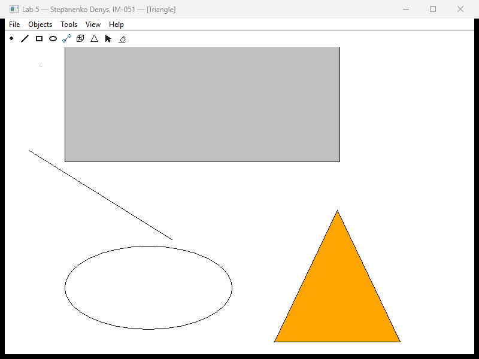
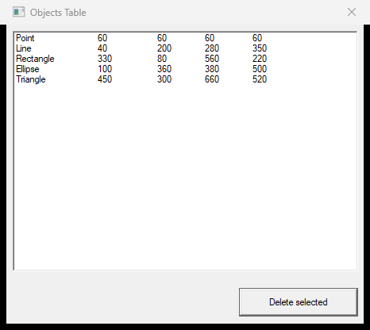
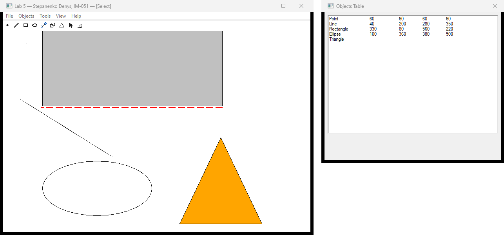
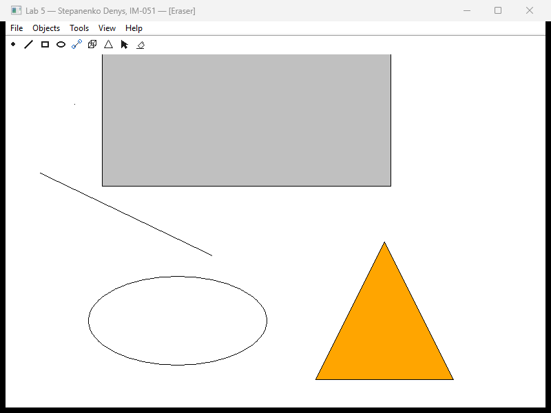
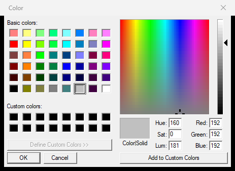
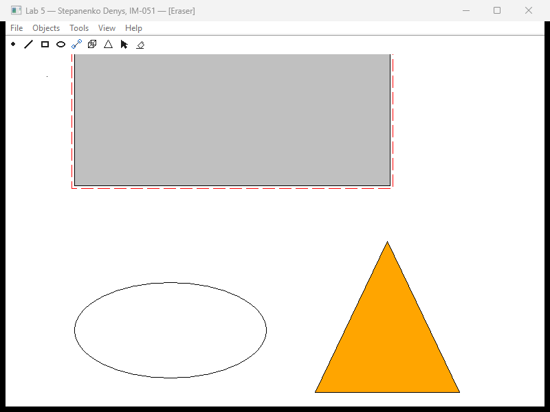
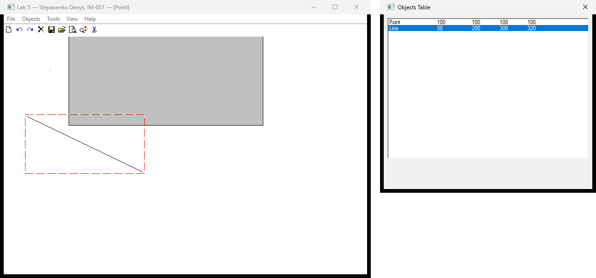
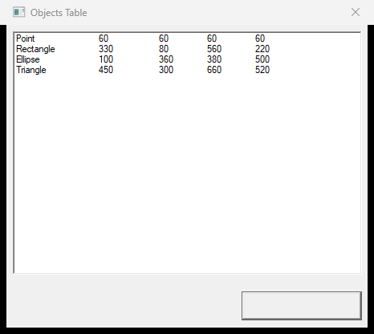

<div style="text-align: center; font-size: 24px; margin-top: 60px;">

Міністерство освіти і науки України

Національний технічний університет України

«Київський політехнічний інститут імені Ігоря Сікорського»

Факультет інформатики та обчислювальної техніки

Кафедра обчислювальної техніки

</div>

<div style="text-align: center; margin-top: 120px;">

<h1 style="font-size: 22px;">Лабораторна робота №5</h1>

<h2 style="font-size: 22px;">з дисципліни «Об'єктно-орієнтоване програмування»</h2>

<h3 style="font-size: 22px; margin-top: 20px;">на тему</h3>

<h2 style="font-size: 22px;">«Багатовіконний інтерфейс користувача на C++»</h2>

</div>

<div style="text-align: right; margin-top: 120px; font-size: 18px;">

<strong>Виконав:</strong><br>
Степаненко Денис<br>
студент групи IM-051<br>
номер у списку групи: 13<br><br>

<strong>Перевірив:</strong><br>
Рекечинський Дмитро Олександрович

</div>

<div style="text-align: center; margin-top: 120px; font-size: 20px;">

Київ 2026

</div>

---

## Завдання

1. Створити у середовищі MS Visual Studio C++ проєкт Win32 з ім'ям Lab5.
2. Написати вихідний текст програми згідно варіанту завдання.
3. Скомпілювати вихідний текст і отримати виконуваний файл програми.
4. Перевірити роботу програми. Налагодити програму.
5. Проаналізувати та прокоментувати результати та вихідний текст програми.

---

## Завдання згідно варіанту

Номер у списку: **Ж = 13 (непарне)**

- **Singleton Меєрса** — локальний статичний об'єкт `static MyEditor instance` усередині `getInstance()`; ініціалізація при першому виклику, потокобезпечно з C++11
- **Незалежний модуль `my_table`** — окремий клас `MyTable` зі своїм `.rc` файлом, не залежить від інших модулів проєкту (не включає їхні `.h` файли)
- **Немодальне вікно таблиці** — `CreateDialog` замість `DialogBox`, обробка через `IsDialogMessage` у циклі повідомлень
- **Запис об'єктів у файл** — tab-separated формат: `назва\tx1\ty1\tx2\ty2`
- **Читання об'єктів із файлу** (бонус) — той самий формат парситься назад, фігури відновлюються на полотні й у таблиці
- **Виділення рядка таблиці → підсвітка об'єкта** (бонус) — клік по рядку обводить фігуру червоною рамкою
- **Виділення рядка → вилучення об'єкта** (бонус) — кнопка «Delete selected» у діалозі таблиці видаляє фігуру й рядок; обидва бонуси реалізовані через callback-вказівники — `my_table` лишається незалежним
- Усі фігури та Toolbar з Lab4 збережено

---

## Вихідний текст програми

### Головний файл Lab5.cpp

```cpp
#include <windows.h>
#include <commctrl.h>
#include <tchar.h>
#include "resource.h"
#include "my_editor.h"
#include "my_table.h"

static MyTable table;
static HINSTANCE g_hInst = NULL;
static HWND g_hMain = NULL;   // repainted from table callbacks

// --- table -> editor hooks (bonus): table only passes a row index ---
static void OnTableRowSelected(int idx)
{
    MyEditor::getInstance()->SelectIndex(idx);   // row -> red frame on canvas
    if (g_hMain) InvalidateRect(g_hMain, NULL, FALSE);
}

static void OnTableRowDeleted(int idx)
{
    if (MyEditor::getInstance()->DeleteIndex(idx) >= 0)
    {
        table.Remove(idx);
        if (g_hMain) InvalidateRect(g_hMain, NULL, FALSE);
    }
}

LRESULT CALLBACK WndProc(HWND hWnd, UINT message, WPARAM wParam, LPARAM lParam)
{
    static HWND hToolBar = NULL;

    switch (message)
    {
    case WM_CREATE:
        // ... toolbar setup ...
        g_hMain = hWnd;
        table.SetOnRowSelect(OnTableRowSelected);   // row -> highlight
        table.SetOnRowDelete(OnTableRowDeleted);    // row -> delete
        MyEditor::getInstance()->SelectShape(IDM_POINT);
        break;

    case WM_COMMAND:
    {
        int wmId = LOWORD(wParam);
        switch (wmId)
        {
        case IDM_POINT: /* ... */ case IDM_CUBE:
            MyEditor::getInstance()->SelectShape(wmId);
            break;
        case IDM_VIEW_TABLE:
            table.Activate(hWnd, g_hInst);  // non-modal table window
            if (table.IsActive()) SyncTableToEditor();
            break;
        case IDM_FILE_SAVE:
            MyEditor::getInstance()->SaveToFile(L"shapes.txt");
            MessageBox(hWnd, _T("Saved to shapes.txt"), _T("File"), MB_OK);
            break;
        case IDM_FILE_LOAD:
        {
            int n = MyEditor::getInstance()->LoadFromFile(L"shapes.txt");
            if (n >= 0) { SyncTableToEditor(); InvalidateRect(hWnd, NULL, FALSE); }
            break;
        }
        // ...
        }
    }
    break;

    case WM_LBUTTONUP:
    {
        MyEditor* editor = MyEditor::getInstance();
        int prevCount = editor->GetCount();
        editor->OnMouseUp(LOWORD(lParam), HIWORD(lParam));

        // Add to table if new shape was added
        if (editor->GetCount() > prevCount && table.IsActive())
        {
            Shape* s = editor->GetShape(editor->GetCount() - 1);
            if (s)
            {
                const wchar_t* name = GetShapeNameW(s);
                int x1, y1, x2, y2;
                s->GetCoords(x1, y1, x2, y2);
                table.Add(name, x1, y1, x2, y2);
            }
        }
        InvalidateRect(hWnd, NULL, TRUE);
    }
    break;

    // ...
    }

    // Message loop with IsDialogMessage for non-modal table
    while (GetMessage(&msg, NULL, 0, 0))
    {
        if (!IsDialogMessage(table.GetHwnd(), &msg))
        {
            TranslateMessage(&msg);
            DispatchMessage(&msg);
        }
    }
}
```

### Клас MyEditor (Singleton) — my_editor.h

```cpp
#pragma once
#include <windows.h>
#include "shape.h"

#define N 117

class MyEditor
{
private:
    Shape* pcshape[N];
    int shapeCount;
    int currentType;
    bool isDrawing;
    Shape* pTempShape;

    MyEditor();
    MyEditor(const MyEditor&) = delete;
    MyEditor& operator=(const MyEditor&) = delete;

    Shape* CreateShape(int type, int x1, int y1, int x2, int y2);

public:
    ~MyEditor();
    static MyEditor* getInstance();

    void OnMouseDown(int x, int y);
    void OnMouseMove(int x, int y, HWND hWnd);
    void OnMouseUp(int x, int y);
    void OnPaint(HDC hdc);
    void SelectShape(int type) { currentType = type; }
    int  GetCount() const { return shapeCount; }
    Shape* GetShape(int i) const { return (i >= 0 && i < shapeCount) ? pcshape[i] : NULL; }

    void SaveToFile(const wchar_t* filename);
    int  LoadFromFile(const wchar_t* filename);   // bonus: restore objects
    void SelectIndex(int idx);                    // bonus: table row -> frame
    int  DeleteIndex(int idx);                    // bonus: table row -> delete
};
```

### MyEditor — my_editor.cpp (Singleton Меєрса + SaveToFile)

```cpp
MyEditor* MyEditor::getInstance()
{
    static MyEditor instance;   // Meyers: function-local static, C++11 thread-safe
    return &instance;
}

void MyEditor::SaveToFile(const wchar_t* filename)
{
    FILE* fout;
    if (_wfopen_s(&fout, filename, L"wt") != 0 || !fout) return;

    for (int i = 0; i < shapeCount; i++)
    {
        const wchar_t* name = pcshape[i]->GetName();   // polymorphic, no dynamic_cast

        int x1, y1, x2, y2;
        pcshape[i]->GetCoords(x1, y1, x2, y2);
        fwprintf(fout, L"%s\t%d\t%d\t%d\t%d\n", name, x1, y1, x2, y2);
    }
    fclose(fout);
}

int MyEditor::LoadFromFile(const wchar_t* filename)   // bonus
{
    FILE* fin;
    if (_wfopen_s(&fin, filename, L"rt") != 0 || !fin) return -1;

    int loaded = 0;
    wchar_t buf[256];
    while (fgetws(buf, 256, fin) && shapeCount < N)
    {
        wchar_t name[64]; int x1, y1, x2, y2;
        if (swscanf(buf, L"%63s %d %d %d %d", name, &x1, &y1, &x2, &y2) != 5)
            continue;                        // skip malformed lines
        int type = TypeFromName(name);       // "Line" -> IDM_LINE, ...
        if (type < 0) continue;
        pcshape[shapeCount] = CreateShape(type, x1, y1, x2, y2);
        if (pcshape[shapeCount]) { shapeCount++; loaded++; }
    }
    fclose(fin);
    return loaded;
}

void MyEditor::SelectIndex(int idx)   // bonus: row i == pcshape[i]
{
    pSelected = (idx >= 0 && idx < shapeCount) ? pcshape[idx] : NULL;
}

int MyEditor::DeleteIndex(int idx)    // bonus: delete by index
{
    if (idx < 0 || idx >= shapeCount) return -1;
    if (pcshape[idx] == pSelected) pSelected = NULL;
    delete pcshape[idx];
    for (int i = idx; i < shapeCount - 1; i++)
        pcshape[i] = pcshape[i + 1];
    pcshape[--shapeCount] = NULL;
    return idx;
}
```

### Незалежний модуль MyTable — my_table.h / my_table.cpp

```cpp
// my_table.h — independent module (no project dependencies)
#pragma once
#include <windows.h>

// Observer-style hook: table reports a row index, owner decides the meaning.
// my_table never knows about shapes or the editor — zero dependencies.
typedef void (*TableRowCallback)(int rowIndex);

class MyTable
{
private:
    HWND hDlg;
    HWND hList;
    int rowCount;
    TableRowCallback onRowSelect;
    TableRowCallback onRowDelete;

public:
    MyTable();
    ~MyTable();

    void Activate(HWND hParent, HINSTANCE hInst);
    void Close();
    void Add(const wchar_t* name, int x1, int y1, int x2, int y2);
    void Remove(int index);
    void Clear();
    bool IsActive() const { return hDlg != NULL; }
    HWND GetHwnd() const { return hDlg; }
    void SetHwnd(HWND hwnd);

    void SetOnRowSelect(TableRowCallback cb) { onRowSelect = cb; }
    void SetOnRowDelete(TableRowCallback cb) { onRowDelete = cb; }
    void NotifyRowSelect(int index) { if (onRowSelect) onRowSelect(index); }
    void NotifyRowDelete(int index) { if (onRowDelete) onRowDelete(index); }
    int  GetSelectedRow() const;
};

#define IDD_TABLE_DIALOG  500
#define IDC_TABLE_LIST    501
#define IDC_TABLE_DELETE  502

// my_table.cpp
void MyTable::Activate(HWND hParent, HINSTANCE hInst)
{
    if (hDlg) { Close(); return; }
    g_pTable = this;
    hDlg = CreateDialog(hInst, MAKEINTRESOURCE(IDD_TABLE_DIALOG),
                        hParent, TableDlgProc);  // non-modal
}

void MyTable::Add(const wchar_t* name, int x1, int y1, int x2, int y2)
{
    if (!hList) return;
    wchar_t buf[256];
    swprintf_s(buf, 256, L"%s\t%d\t%d\t%d\t%d", name, x1, y1, x2, y2);
    SendMessageW(hList, LB_ADDSTRING, 0, (LPARAM)buf);
    rowCount++;
    SendMessageW(hList, LB_SETTOPINDEX, rowCount - 1, 0);  // auto-scroll
}

// TableDlgProc: row events are forwarded to the owner via callbacks
case WM_COMMAND:
    if (LOWORD(wParam) == IDC_TABLE_LIST && HIWORD(wParam) == LBN_SELCHANGE)
    {
        g_pTable->NotifyRowSelect(g_pTable->GetSelectedRow());   // row -> highlight
        return TRUE;
    }
    if (LOWORD(wParam) == IDC_TABLE_DELETE)
    {
        g_pTable->NotifyRowDelete(g_pTable->GetSelectedRow());   // row -> delete
        return TRUE;
    }
    break;
```

---

## Діаграми

### Діаграма залежностей файлів та модулів

```
Lab5.cpp
├── <windows.h>
├── <commctrl.h>
├── <tchar.h>
├── resource.h
├── my_editor.h
│   └── shape.h
└── my_table.h
    └── <windows.h>

my_editor.cpp
├── my_editor.h
├── point.h, line.h, rect.h, ellipse.h
├── linecircles.h, cube.h
└── resource.h

my_table.cpp
└── my_table.h           ← НЕ залежить від інших модулів проєкту

my_table.rc
└── my_table.h           ← ресурс IDs
```

**Важливо:** модуль `my_table` не включає жодних `.h` файлів проєкту окрім власного — повна незалежність.

### Діаграма класів (UML)

```
┌──────────────────────────────┐
│   MyEditor (Singleton)       │
├──────────────────────────────┤
│ - instance: static (Meyers)  │  ← static у getInstance()
│ - pcshape[N]: Shape*         │
│ - shapeCount: int            │
│ - currentType: int           │
│ - isDrawing: bool            │
│ - pTempShape: Shape*         │
├──────────────────────────────┤
│ - MyEditor()                 │  ← private ctor
│ - MyEditor(const&) = delete  │  ← no copy
│ - operator=(const&) = delete │  ← no assign
├──────────────────────────────┤
│ + getInstance(): MyEditor*   │  ← if(!p) p=new MyEd
│ + OnMouseDown(x, y)          │
│ + OnMouseMove(x, y, hWnd)    │
│ + OnMouseUp(x, y)            │
│ + OnPaint(hdc)               │  ← dashed rubber band
│ + SelectShape(type)          │
│ + GetCount(): int            │
│ + GetShape(i): Shape*        │
│ + SaveToFile(filename)       │  ← tab-separated
│ + CreateShape(type, ...)     │  ← factory
└──────────────┬───────────────┘
               │ manages Shape*
               ▼
┌─────────────────────────────┐
│      Shape (abstract)       │
├─────────────────────────────┤
│ # x1, y1, x2, y2: int       │
│ + Show(HDC) = 0             │
│ + OnMouseDown(x,y)          │
│ + OnMouseMove(x,y)          │
└──────────────┬──────────────┘
               │
   ┌───────────┼───────────┬──────────┐
   │           │           │          │
┌──▼──────┐ ┌──▼──────┐ ┌──▼──────┐ ┌─▼────────┐
│PointShape│ │LineShape│ │RectShape│ │EllipseShp│
└──────────┘ └────┬────┘ └────┬────┘ └─────┬────┘
                  │           │             │
            ┌─────┘     ┌─────┘             │
            ▼           ▼                   │
   ┌──────────────┐  ┌──────────────┐      │
   │LineWithCirc  │  │CubeWireframe │      │
   │: Line+Ellip  │  │: Line+Rect   │      │
   └──────────────┘  └──────────────┘      │
                                          │
┌──────────────────────────────┐          │
│        MyTable               │          │
├──────────────────────────────┤          │
│ - hDlg: HWND                 │          │
│ - hList: HWND                │          │
│ - rowCount: int              │          │
├──────────────────────────────┤          │
│ + Activate(parent, inst)     │ ← CreateDialog (non-modal)
│ + Close()                    │ ← DestroyWindow
│ + Add(name, x1,y1,x2,y2)     │ ← LB_ADDSTRING
│ + Clear()                    │ ← LB_RESETCONTENT
│ + IsActive(): bool           │
│ + GetHwnd(): HWND            │
│ + SetHwnd(hwnd)              │
└──────────────────────────────┘
     ↑ НЕ залежить від Shape/MyEditor
```

---

## Скріншоти

### Головне вікно з фігурами



_Рис. 1. Головне вікно редактора: 7 типів фігур, тулбар, меню «View → Table» та «File → Save»_

---

### Немодальне вікно таблиці



_Рис. 2. Немодальне вікно таблиці об'єктів — рядки додаються автоматично при створенні фігури, колонки name / x1 / y1 / x2 / y2_

---

### Головне вікно + таблиця одночасно



_Рис. 3. Багатовіконний інтерфейс — головне вікно та таблиця працюють одночасно_

---

### Збереження у файл



_Рис. 4. File → Save записує об'єкти у shapes.txt у tab-separated форматі (`name\tx1\ty1\tx2\ty2`)_

---

### Інструмент «Вибір» — рамка навколо обраної фігури


_Рис. 5. Select: клік по еліпсу → червона пунктирна рамка (`HitTest` + `GetBounds`)_

---

### Діалог вибору кольору заливки



_Рис. 6. Tools → Fill color → стандартний діалог `ChooseColor`_

---

### Заливка застосована до обраної фігури


_Рис. 7. Після вибору кольору обраний еліпс залито (`SetFillColor` + `m_hasFill`)_

---

### Інструмент «Губка» — видалення фігури



_Рис. 8. Губка видалила лінію (клік по фігурі → `HitTest` зверху-вниз → delete + зсув масиву)_

---

### Завантаження об'єктів з файлу



_Рис. 9. File → Load: три об'єкти відновлено з `shapes.txt`, таблиця наповнилась; клік по рядку «Line» обвів лінію червоною пунктирною рамкою_

---

### Видалення об'єкта через рядок таблиці


_Рис. 10. Кнопка «Delete selected» у діалозі таблиці: обраний рядок «Line» зник, лінія видалена з полотна — синхронізація в обидва боки_

---

### Таблиця синхронізована після видалення



_Рис. 11. Рядок «Line» зник із таблиці разом із фігурою (`MyTable::Remove` → `LB_DELETESTRING`)_

---

## Додаткові можливості (понад специфікацію)

Понад вимоги варіанта реалізовано розширений інструментарій редактора:

| Функція | Реалізація |
|---|---|
| **7-й тип фігури — трикутник** | `TriangleShape` (нащадок `Shape`), ввід двома кутами рамки, помаранчева заливка; `HitTest` через `CreatePolygonRgn` + `PtInRegion` |
| **Інструмент «Вибір» (Select)** | клік по фігурі → `HitTest` зверху-вниз → `pSelected`; обрана фігура обводиться червоною пунктирною рамкою (`GetBounds` + `InflateRect`) |
| **Інструмент «Губка» (Eraser)** | клік видаляє верхню фігуру під курсором: `delete` + зсув масиву; рядок таблиці видаляється синхронно (`MyTable::Remove` → `LB_DELETESTRING`) |
| **Колір заливки** | меню Tools → Fill color → стандартний діалог `ChooseColor` → `pSelected->SetFillColor()` |
| **Колір контуру** | меню Tools → Pen color → `ChooseColor` → `pSelected->SetPenColor()` |
| **Del — видалення обраної фігури** | `WM_KEYDOWN` + `VK_DELETE` → `DeleteSelected()` + синхронізація таблиці |
| **Очищення полотна** | меню File → Clear canvas → `ClearAll()` (delete всіх об'єктів) + `MyTable::Clear()` |
| **Завантаження з файлу** | меню File → Load → `LoadFromFile()` парсить рядки `назва\tx1\ty1\tx2\ty2`, `TypeFromName` відновлює тип, `CreateShape` створює об'єкти; таблиця перебудовується через `SyncTableToEditor()` |
| **Рядок таблиці → підсвітка фігури** | `LBN_SELCHANGE` → `MyTable::NotifyRowSelect` → callback `OnTableRowSelected` → `SelectIndex()` → `InvalidateRect` → червона пунктирна рамка |
| **Рядок таблиці → вилучення фігури** | кнопка «Delete selected» у діалозі → `NotifyRowDelete` → `DeleteIndex()` видаляє об'єкт → `MyTable::Remove` видаляє рядок |

Зворотній напрямок таблиця→редактор реалізовано через **callback-вказівники**
(`TableRowCallback`): `my_table` лише повідомляє індекс рядка і не знає нічого
про фігури чи редактор — модуль залишається повністю незалежним.

Кожна фігура тепер має поля `m_fillColor / m_penColor / m_penStyle / m_hasFill`,
віртуальні `HitTest()` / `GetBounds()` (перевизначені там, де рамка не дорівнює
дійсній формі: лінія — відстань до відрізка, еліпс — рівняння еліпса, точка —
допуск ±6px, прямокутник — bounds з урахуванням вводу від центру) та
поліморфний `GetName()` для таблиці й файлу.

---

## Висновки

У лабораторній роботі я виконав завдання згідно свого варіанту (Ж = 13, непарне). Реалізовано патерн Singleton Меєрса для класу `MyEditor` — приватний конструктор, локальний статичний об'єкт `static MyEditor instance` усередині `getInstance()`, ініціалізація при першому зверненні (з C++11 потокобезпечна). Копіювання та присвоєвання заборонено через `= delete`.

Створено незалежний модуль `my_table` — клас `MyTable` зі своїм файлом ресурсів `.rc`, що не залежить від інших модулів проєкту. Немодальне вікно таблиці створюється через `CreateDialog` і обробляється через `IsDialogMessage` у головному циклі повідомлень — це дозволяє працювати з обома вікнами одночасно.

Додано запис об'єктів у файл у tab-separated форматі: `назва\tx1\ty1\tx2\ty2`. Ім'я типу об'єкта отримується поліморфно через віртуальний метод `GetName()`. Понад специфікацію реалізовано читання того самого формату назад — `LoadFromFile` відновлює множину об'єктів на полотні та перебудовує таблицю.

Окремо варто відзначити **двосторонню синхронізацію** таблиці й полотна: виділення рядка таблиці обводить відповідну фігуру червоною рамкою, а кнопка «Delete selected» видаляє і рядок, і об'єкт. Зв'язок таблиця→редактор зроблено через callback-вказівники функції (`TableRowCallback`) — модуль `my_table` залишається повністю незалежним і нічого не знає про фігури.

Лабораторна робота дала практичні навички використання патерну Singleton, створення незалежних модулів, роботи з немодальними діалоговими вікнами, запису й читання даних з файлу, а також організації зворотного зв'язку між компонентами через callback-механізм.
