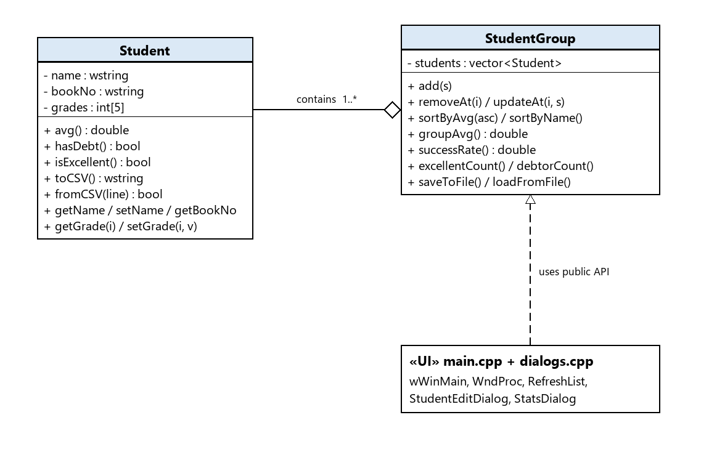
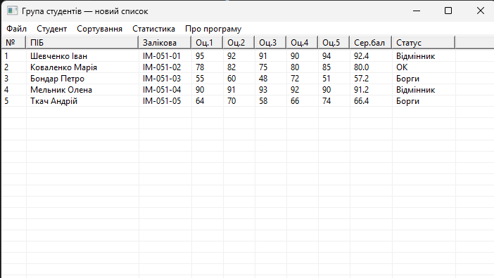
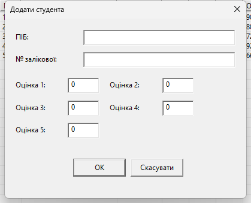
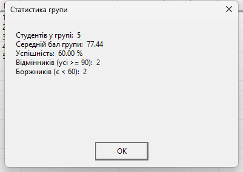

<div style="text-align: center; font-size: 24px; margin-top: 60px;">

Міністерство освіти і науки України

Національний технічний університет України

«Київський політехнічний інститут імені Ігоря Сікорського»

Факультет інформатики та обчислювальної техніки

Кафедра обчислювальної техніки

</div>

<div style="text-align: center; margin-top: 120px;">

<h1 style="font-size: 22px;">РОЗРАХУНКОВО-ГРАФІЧНА РОБОТА</h1>

<h2 style="font-size: 22px;">з дисципліни «Об'єктно-орієнтоване програмування»</h2>

<h3 style="font-size: 22px; margin-top: 20px;">на тему</h3>

<h2 style="font-size: 22px;">«Програма списку студентів групи з розрахунками успішності»</h2>

</div>

<div style="text-align: right; margin-top: 120px; font-size: 18px;">

<strong>Виконав:</strong><br>
Степаненко Денис<br>
студент групи ІМ-051<br>
номер у списку групи: 13<br><br>

<strong>Перевірив:</strong><br>
Олійниченко Оксана Олександрівна

</div>

<div style="text-align: center; margin-top: 120px; font-size: 20px;">

Київ 2026

</div>

---

## 1. Обґрунтування проектного рішення

### 1.1 Аналіз можливих варіантів реалізації

**Інтерфейс користувача.** Можливі варіанти: консольна програма,
GUI на Win32 API, GUI на каркасі (MFC/Qt). Консоль простіша, але
табличне відображення та меню у ній громіздкі; каркаси тягнуть
зовнішні залежності. Обрано **Win32 API**: курс ООП будується на
ньому, програма — один легкий exe без бібліотек, а `ListView`
дає готову таблицю.

**Контейнер даних.** Статичний масив (як у лаб. 2–4) вимагає
лічильника і обмежує кількість студентів; власний список —
зайва складність. Обрано `std::vector<Student>` усередині класу
`StudentGroup`: динамічний розмір, готовий `std::sort`, а
інкапсуляція забороняє UI торкатися контейнера напряму.

**Формат зберігання.** Бінарний файл компактний, але нечитабельний;
plain text — важко парсити кирилицю. Обрано **CSV (`;`) у UTF-8
з BOM**: відкривається в Excel і Блокноті, сумісний з вимогою
«збереження/завантаження з файлу».

**Діалоги.** Add/Edit реалізовані одним модальним
`DialogBoxParam` + `DlgProc`: форма має бути заповнена до
повернення керування, а контекст (`EditCtx`: заголовок,
вказівник на результат, прапорець ok) передається через `lParam`.

### 1.2 Обране рішення

Двошарова архітектура «модель + UI»:

- **модель** — класи `Student` та `StudentGroup`: чисте ООП,
  жодного `#include <windows.h>`;
- **інтерфейс** — `main.cpp` (вікно, `ListView`, меню) та
  `dialogs.cpp` (модальні діалоги), які працюють з даними
  лише через публічні методи моделі.

| Рішення | Обґрунтування |
|---------|---------------|
| `vector<Student>` усередині класу | інкапсуляція — UI не торкається контейнера напряму |
| `wstring`/`wifstream` + `codecvt_utf8_utf16` | коректна українська кирилиця у файлі |
| `ListView` у режимі `LVS_REPORT` | стандартна таблиця Windows, 10 колонок |
| Один `DlgProc` для Add і Edit | режим визначається полем `ctx.title`, без дублювання коду |
| Формат CSV (`;`) + BOM | сумісний з Excel, читається людиною |
| Статус обчислюється на льоту | похідна величина `f(оцінки)` — не дублюється у файлі |

## 2. Пояснювальна записка

### 2.1 Завдання

Розробити програму для ведення списку студентів групи з
розрахунками успішності: додавання/редагування/видалення,
табличне відображення, сортування, статистика групи,
збереження та завантаження файлу.

### 2.2 Теоретичні положення

Клас `Student` зберігає дані студента (ПІБ, № залікової,
5 оцінок 0–100) і реалізує похідні розрахунки: `avg()`,
`hasDebt()` (оцінка < 60), `isExcellent()` (усі >= 90),
а також серіалізацію `toCSV()/fromCSV()`.

Клас `StudentGroup` інкапсулює `vector<Student>`: операції
add/update/remove, сортування за балом і ПІБ, статистику
групи (середній бал, % успішності, відмінники, боржники),
збереження/завантаження CSV.

UI-шар — вікно з `ListView` (`LVS_REPORT`), меню
Файл/Студент/Сортування/Статистика, модальні діалоги.
Розрахунки виконуються моделлю; UI лише відображає
результат (`RefreshList` читає `const Student*`).

### 2.3 Збірка та запуск (MinGW)

```
cd labs\rgr\code\src
g++ -c -std=c++14 -DUNICODE -D_UNICODE student.cpp student_group.cpp dialogs.cpp main.cpp
windres -c 65001 --output-format=coff -I . -i ..\res\RGR.rc -o RGR.res.o
g++ -mwindows -municode *.o -o RGR.exe -lcomctl32
.\RGR.exe
```

### 2.4 Висновки

Розроблено програму ведення списку студентів групи з повним
набором розрахунків успішності. Архітектура «модель + UI»:
класи `Student`/`StudentGroup` не залежать від інтерфейсу,
що дозволяє перевикористати їх у консольній версії. Реалізовано
додавання/редагування/видалення, сортування за балом і ПІБ,
статистику (середній бал, % успішності, відмінники, боржники),
збереження/завантаження CSV-файлу з підтримкою кирилиці.

## 3. Вихідні тексти усіх модулів програми

### resource.h

```cpp
// resource.h — ідентифікатори ресурсів та команд (РГР)
#pragma once

// --- меню: Файл ---
#define IDM_FILE_NEW    40001
#define IDM_FILE_OPEN   40002
#define IDM_FILE_SAVE   40003
#define IDM_FILE_SAVEAS 40004
#define IDM_FILE_EXIT   40005

// --- меню: Студент ---
#define IDM_ST_ADD      40010
#define IDM_ST_EDIT     40011
#define IDM_ST_REMOVE   40012

// --- меню: Сортування ---
#define IDM_SORT_AVG    40020
#define IDM_SORT_NAME   40021

// --- меню: Статистика / Довідка ---
#define IDM_STATS_SHOW  40030
#define IDM_ABOUT       40040

// --- діалог Add/Edit ---
#define IDD_STUDENT     50001
#define IDC_ED_NAME     50101
#define IDC_ED_BOOK     50102
#define IDC_ED_G1       50103
#define IDC_ED_G2       50104
#define IDC_ED_G3       50105
#define IDC_ED_G4       50106
#define IDC_ED_G5       50107

// --- діалог статистики ---
#define IDD_STATS       50002
#define IDC_STATS_TEXT  50201

#define IDC_LIST        60001
```

### student.h

```cpp
#pragma once
// ============================================================
// Student.h — студент групи (РГР, варіант 13)
// Дані: ПІБ, номер залікової книжки, 5 оцінок (0–100).
// Похідні: середній бал, боржник (<60), відмінник (усі >=90).
// ============================================================
#include <string>

class Student
{
public:
    static const int GRADE_COUNT = 5;

private:
    std::wstring name;      // ПІБ
    std::wstring bookNo;    // номер залікової книжки
    int grades[GRADE_COUNT];// оцінки 0..100

public:
    Student();
    Student(const std::wstring& name, const std::wstring& bookNo);

    // --- доступ ---
    const std::wstring& getName()   const { return name; }
    const std::wstring& getBookNo() const { return bookNo; }
    int getGrade(int i) const;
    const int* getGrades() const { return grades; }

    void setName(const std::wstring& v)   { name = v; }
    void setBookNo(const std::wstring& v) { bookNo = v; }
    void setGrade(int i, int v);

    // --- розрахунки успішності ---
    double avg()         const;   // середній бал
    bool   hasDebt()     const;   // є хоча б одна оцінка < 60
    bool   isExcellent() const;   // усі оцінки >= 90

    // --- файл (CSV, поля розділені ;) ---
    std::wstring toCSV() const;                    // рядок для запису
    bool fromCSV(const std::wstring& line);        // парсинг, false = поганий рядок
};
```

### student.cpp

```cpp
// Student.cpp — реалізація класу Student
#include "student.h"
#include <sstream>

Student::Student()
{
    for (int i = 0; i < GRADE_COUNT; i++) grades[i] = 0;
}

Student::Student(const std::wstring& n, const std::wstring& b)
    : name(n), bookNo(b)
{
    for (int i = 0; i < GRADE_COUNT; i++) grades[i] = 0;
}

int Student::getGrade(int i) const
{
    if (i < 0 || i >= GRADE_COUNT) return 0;
    return grades[i];
}

void Student::setGrade(int i, int v)
{
    if (i < 0 || i >= GRADE_COUNT) return;
    if (v < 0) v = 0;
    if (v > 100) v = 100;
    grades[i] = v;
}

double Student::avg() const
{
    double sum = 0.0;
    for (int i = 0; i < GRADE_COUNT; i++) sum += grades[i];
    return sum / GRADE_COUNT;
}

bool Student::hasDebt() const
{
    for (int i = 0; i < GRADE_COUNT; i++)
        if (grades[i] < 60) return true;
    return false;
}

bool Student::isExcellent() const
{
    for (int i = 0; i < GRADE_COUNT; i++)
        if (grades[i] < 90) return false;
    return true;
}

// "ПІБ;ЗАЛІКОВКА;g1;g2;g3;g4;g5"
std::wstring Student::toCSV() const
{
    std::wstringstream ss;
    ss << name << L';' << bookNo;
    for (int i = 0; i < GRADE_COUNT; i++) ss << L';' << grades[i];
    return ss.str();
}

bool Student::fromCSV(const std::wstring& line)
{
    std::wstringstream ss(line);
    std::wstring field;
    if (!std::getline(ss, field, L';')) return false;
    name = field;
    if (!std::getline(ss, field, L';')) return false;
    bookNo = field;
    for (int i = 0; i < GRADE_COUNT; i++)
    {
        if (!std::getline(ss, field, L';')) return false;
        grades[i] = _wtoi(field.c_str());
    }
    return true;
}
```

### student_group.h

```cpp
#pragma once
// ============================================================
// StudentGroup.h — контейнер групи студентів (РГР, варіант 13)
// vector<Student> + операції: add/edit/remove, сортування,
// статистика групи, збереження/завантаження CSV-файлу.
// ============================================================
#include <vector>
#include <string>
#include "student.h"

class StudentGroup
{
private:
    std::vector<Student> students;

public:
    // --- базові операції ---
    void add(const Student& s)        { students.push_back(s); }
    bool removeAt(size_t i);
    bool updateAt(size_t i, const Student& s);
    void clear()                      { students.clear(); }

    size_t size() const               { return students.size(); }
    const Student* at(size_t i) const;
    Student* at(size_t i);

    // --- сортування ---
    void sortByAvg(bool ascending);   // за середнім балом
    void sortByName();                // за ПІБ (алфавіт)

    // --- статистика групи ---
    double groupAvg() const;          // середній бал усієї групи
    double successRate() const;       // % студентів без боргів
    int excellentCount() const;       // к-сть відмінників
    int debtorCount() const;          // к-сть боржників

    // --- файл (CSV; заголовок-рядок пропускається) ---
    bool saveToFile(const std::wstring& path) const;
    bool loadFromFile(const std::wstring& path);
};
```

### student_group.cpp

```cpp
// StudentGroup.cpp — реалізація контейнера групи
#include "student_group.h"
#include <algorithm>
#include <fstream>
#include <locale>
#include <codecvt>

bool StudentGroup::removeAt(size_t i)
{
    if (i >= students.size()) return false;
    students.erase(students.begin() + i);
    return true;
}

bool StudentGroup::updateAt(size_t i, const Student& s)
{
    if (i >= students.size()) return false;
    students[i] = s;
    return true;
}

const Student* StudentGroup::at(size_t i) const
{
    if (i >= students.size()) return nullptr;
    return &students[i];
}

Student* StudentGroup::at(size_t i)
{
    if (i >= students.size()) return nullptr;
    return &students[i];
}

void StudentGroup::sortByAvg(bool ascending)
{
    std::sort(students.begin(), students.end(),
        [ascending](const Student& a, const Student& b)
        {
            return ascending ? a.avg() < b.avg() : a.avg() > b.avg();
        });
}

void StudentGroup::sortByName()
{
    std::sort(students.begin(), students.end(),
        [](const Student& a, const Student& b)
        {
            return a.getName() < b.getName();
        });
}

double StudentGroup::groupAvg() const
{
    if (students.empty()) return 0.0;
    double sum = 0.0;
    for (const auto& s : students) sum += s.avg();
    return sum / students.size();
}

double StudentGroup::successRate() const
{
    if (students.empty()) return 0.0;
    int ok = 0;
    for (const auto& s : students)
        if (!s.hasDebt()) ok++;
    return 100.0 * ok / students.size();
}

int StudentGroup::excellentCount() const
{
    int n = 0;
    for (const auto& s : students)
        if (s.isExcellent()) n++;
    return n;
}

int StudentGroup::debtorCount() const
{
    int n = 0;
    for (const auto& s : students)
        if (s.hasDebt()) n++;
    return n;
}

// CSV-формат: ПІБ;ЗАЛІКОВКА;g1;g2;g3;g4;g5  (UTF-8, BOM)
bool StudentGroup::saveToFile(const std::wstring& path) const
{
    std::wofstream f(path.c_str(), std::ios::out | std::ios::trunc);
    if (!f.is_open()) return false;
    f.imbue(std::locale(f.getloc(), new std::codecvt_utf8_utf16<wchar_t>));
    f << L'\xFEFF';
    f << L"Name;BookNo;G1;G2;G3;G4;G5\n";
    for (const auto& s : students)
        f << s.toCSV() << L'\n';
    return true;
}

bool StudentGroup::loadFromFile(const std::wstring& path)
{
    std::wifstream f(path.c_str());
    if (!f.is_open()) return false;
    f.imbue(std::locale(f.getloc(), new std::codecvt_utf8_utf16<wchar_t>));

    students.clear();
    std::wstring line;
    bool first = true;
    while (std::getline(f, line))
    {
        if (first)   // заголовок (і BOM) пропускаємо
        {
            first = false;
            if (!line.empty() && line[0] == L'\xFEFF') line.erase(0, 1);
            if (line.find(L"Name") == 0) continue;
        }
        if (line.empty()) continue;
        Student s;
        if (s.fromCSV(line)) students.push_back(s);
    }
    return true;
}
```

### dialogs.h

```cpp
#pragma once
// dialogs.h — модальні діалоги програми (РГР)
#include <windows.h>
#include "student.h"
#include "student_group.h"

// Діалог вводу/редагування студента.
// Повертає TRUE якщо OK і out заповнений валідними даними.
BOOL StudentEditDialog(HWND hOwner, const wchar_t* title, Student& out);

// Діалог статистики групи.
void StatsDialog(HWND hOwner, const StudentGroup& group);
```

### dialogs.cpp

```cpp
// dialogs.cpp — реалізація діалогів (РГР)
#include "dialogs.h"
#include "resource.h"
#include <sstream>

// ---- контекст діалогу Add/Edit ----
struct EditCtx
{
    const wchar_t* title;
    Student* result;
    BOOL ok;
};

static int GetGradeField(HWND hDlg, int idc)
{
    wchar_t buf[16];
    GetDlgItemTextW(hDlg, idc, buf, 16);
    return _wtoi(buf);
}

static void SetGradeField(HWND hDlg, int idc, int v)
{
    wchar_t buf[16];
    _itow_s(v, buf, 10);
    SetDlgItemTextW(hDlg, idc, buf);
}

static INT_PTR CALLBACK StudentDlgProc(HWND hDlg, UINT msg, WPARAM wp, LPARAM lp)
{
    static EditCtx* ctx = nullptr;
    switch (msg)
    {
    case WM_INITDIALOG:
        ctx = reinterpret_cast<EditCtx*>(lp);
        SetWindowTextW(hDlg, ctx->title);
        if (ctx->result)
        {
            SetDlgItemTextW(hDlg, IDC_ED_NAME, ctx->result->getName().c_str());
            SetDlgItemTextW(hDlg, IDC_ED_BOOK, ctx->result->getBookNo().c_str());
            for (int i = 0; i < Student::GRADE_COUNT; i++)
                SetGradeField(hDlg, IDC_ED_G1 + i, ctx->result->getGrade(i));
        }
        return TRUE;

    case WM_COMMAND:
        if (LOWORD(wp) == IDOK)
        {
            Student s;
            wchar_t buf[128];
            GetDlgItemTextW(hDlg, IDC_ED_NAME, buf, 128);
            s.setName(buf);
            GetDlgItemTextW(hDlg, IDC_ED_BOOK, buf, 128);
            s.setBookNo(buf);
            for (int i = 0; i < Student::GRADE_COUNT; i++)
                s.setGrade(i, GetGradeField(hDlg, IDC_ED_G1 + i));

            if (s.getName().empty())
            {
                MessageBoxW(hDlg, L"Введіть ПІБ студента!", L"Помилка", MB_ICONWARNING);
                return TRUE;
            }
            *ctx->result = s;
            ctx->ok = TRUE;
            EndDialog(hDlg, IDOK);
            return TRUE;
        }
        if (LOWORD(wp) == IDCANCEL)
        {
            ctx->ok = FALSE;
            EndDialog(hDlg, IDCANCEL);
            return TRUE;
        }
        break;
    }
    return FALSE;
}

BOOL StudentEditDialog(HWND hOwner, const wchar_t* title, Student& out)
{
    EditCtx ctx;
    ctx.title = title;
    ctx.result = &out;
    ctx.ok = FALSE;
    DialogBoxParamW(GetModuleHandleW(nullptr), MAKEINTRESOURCEW(IDD_STUDENT),
                    hOwner, StudentDlgProc, reinterpret_cast<LPARAM>(&ctx));
    return ctx.ok;
}

// ---- статистика: текст формується тут, показ у діалозі ----
static std::wstring g_statsText;

static INT_PTR CALLBACK StatsDlgProc(HWND hDlg, UINT msg, WPARAM wp, LPARAM lp)
{
    switch (msg)
    {
    case WM_INITDIALOG:
        SetDlgItemTextW(hDlg, IDC_STATS_TEXT, g_statsText.c_str());
        return TRUE;
    case WM_COMMAND:
        if (LOWORD(wp) == IDOK || LOWORD(wp) == IDCANCEL)
        {
            EndDialog(hDlg, LOWORD(wp));
            return TRUE;
        }
        break;
    }
    return FALSE;
}

void StatsDialog(HWND hOwner, const StudentGroup& group)
{
    std::wstringstream ss;
    ss.setf(std::ios::fixed); ss.precision(2);
    ss << L"Студентів у групі:  " << group.size() << L"\r\n";
    ss << L"Середній бал групи:  " << group.groupAvg() << L"\r\n";
    ss << L"Успішність:  " << group.successRate() << L" %\r\n";
    ss << L"Відмінників (усі >= 90):  " << group.excellentCount() << L"\r\n";
    ss << L"Боржників (є < 60):  " << group.debtorCount();
    g_statsText = ss.str();

    DialogBoxParamW(GetModuleHandleW(nullptr), MAKEINTRESOURCEW(IDD_STATS),
                    hOwner, StatsDlgProc, 0);
}
```

### main.cpp

```cpp
// ============================================================
// main.cpp — РГР, варіант 13
// Програма списку студентів групи з розрахунками успішності.
// Головне вікно: ListView (таблиця) + меню Файл/Студент/
// Сортування/Статистика. Діалоги Add/Edit — окремий модуль.
//
// Build & run (MinGW, з папки code\src):
//   g++ -c -std=c++14 -DUNICODE -D_UNICODE *.cpp
//   windres -c 65001 --output-format=coff -I . -i ..\res\RGR.rc -o RGR.res.o
//   g++ -mwindows -municode *.o -o RGR.exe -lcomctl32
//   .\RGR.exe
// (точні команди — у labs\rgr\README.md)
//
// Архітектура (модель ↔ UI):
//   student.h/.cpp        — модель: дані студента + розрахунки,
//                           жодного Win32 — чисте ООП
//   student_group.h/.cpp  — контейнер vector<Student>: сортування,
//                           статистика, save/load CSV
//   dialogs.h/.cpp        — модальні діалоги (DialogBoxParam+EditCtx)
//   main.cpp              — UI-шар: вікно, ListView, меню, WndProc.
//                           Працює тільки через публічні методи групи.
// ============================================================
#include <windows.h>
#include <commctrl.h>
#include <stdio.h>
#include "resource.h"
#include "student.h"
#include "student_group.h"
#include "dialogs.h"

static StudentGroup g_group;
static HWND g_hList = nullptr;
static wchar_t g_filePath[MAX_PATH] = L"";

// ---------- ListView ----------

static void InitListView(HWND hList)
{
    ListView_SetExtendedListViewStyle(hList,
        LVS_EX_FULLROWSELECT | LVS_EX_GRIDLINES);

    const wchar_t* titles[] = {
        L"№", L"ПІБ", L"Залікова", L"Оц.1", L"Оц.2", L"Оц.3",
        L"Оц.4", L"Оц.5", L"Сер.бал", L"Статус"
    };
    const int widths[] = { 35, 160, 75, 45, 45, 45, 45, 45, 60, 90 };

    for (int i = 0; i < 10; i++)
    {
        LVCOLUMNW col = {};
        col.mask = LVCF_TEXT | LVCF_WIDTH | LVCF_SUBITEM;
        col.cx = widths[i];
        col.pszText = const_cast<LPWSTR>(titles[i]);
        col.iSubItem = i;
        ListView_InsertColumn(hList, i, &col);
    }
}

static void RefreshList()
{
    ListView_DeleteAllItems(g_hList);
    wchar_t buf[32];
    for (size_t i = 0; i < g_group.size(); i++)
    {
        const Student* s = g_group.at(i);

        LVITEMW it = {};
        it.mask = LVIF_TEXT;
        it.iItem = (int)i;
        swprintf_s(buf, L"%d", (int)i + 1);
        it.pszText = buf;
        ListView_InsertItem(g_hList, &it);

        ListView_SetItemText(g_hList, (int)i, 1,
            const_cast<LPWSTR>(s->getName().c_str()));
        ListView_SetItemText(g_hList, (int)i, 2,
            const_cast<LPWSTR>(s->getBookNo().c_str()));
        for (int g = 0; g < Student::GRADE_COUNT; g++)
        {
            swprintf_s(buf, L"%d", s->getGrade(g));
            ListView_SetItemText(g_hList, (int)i, 3 + g, buf);
        }
        swprintf_s(buf, L"%.1f", s->avg());
        ListView_SetItemText(g_hList, (int)i, 8, buf);

        const wchar_t* status = s->isExcellent() ? L"Відмінник" :
                                (s->hasDebt()   ? L"Борги" : L"ОК");
        ListView_SetItemText(g_hList, (int)i, 9, const_cast<LPWSTR>(status));
    }
}

static int SelectedRow()
{
    return ListView_GetNextItem(g_hList, -1, LVNI_SELECTED);
}

// ---------- дії ----------

static void UpdateTitle(HWND hWnd)
{
    wchar_t title[MAX_PATH + 64];
    if (g_filePath[0])
        swprintf_s(title, L"Група студентів — %s", g_filePath);
    else
        swprintf_s(title, L"Група студентів — новий список");
    SetWindowTextW(hWnd, title);
}

static bool AskSavePath(HWND hWnd)
{
    wchar_t path[MAX_PATH] = L"group.csv";
    OPENFILENAMEW ofn = {};
    ofn.lStructSize = sizeof(ofn);
    ofn.hwndOwner = hWnd;
    ofn.lpstrFile = path;
    ofn.nMaxFile = MAX_PATH;
    ofn.lpstrFilter = L"CSV файли (*.csv)\0*.csv\0Усі файли (*.*)\0*.*\0";
    ofn.Flags = OFN_OVERWRITEPROMPT;
    if (!GetSaveFileNameW(&ofn)) return false;
    wcscpy_s(g_filePath, path);
    return true;
}

static void DoSave(HWND hWnd, bool saveAs)
{
    if (saveAs || !g_filePath[0])
        if (!AskSavePath(hWnd)) return;
    if (g_group.saveToFile(g_filePath))
        UpdateTitle(hWnd);
    else
        MessageBoxW(hWnd, L"Не вдалося зберегти файл!", L"Помилка", MB_ICONERROR);
}

static void DoOpen(HWND hWnd)
{
    wchar_t path[MAX_PATH] = L"";
    OPENFILENAMEW ofn = {};
    ofn.lStructSize = sizeof(ofn);
    ofn.hwndOwner = hWnd;
    ofn.lpstrFile = path;
    ofn.nMaxFile = MAX_PATH;
    ofn.lpstrFilter = L"CSV файли (*.csv)\0*.csv\0Усі файли (*.*)\0*.*\0";
    ofn.Flags = OFN_FILEMUSTEXIST;
    if (!GetOpenFileNameW(&ofn)) return;

    if (g_group.loadFromFile(path))
    {
        wcscpy_s(g_filePath, path);
        RefreshList();
        UpdateTitle(hWnd);
    }
    else
        MessageBoxW(hWnd, L"Не вдалося відкрити файл!", L"Помилка", MB_ICONERROR);
}

static void DoAdd(HWND hWnd)
{
    Student s;
    if (StudentEditDialog(hWnd, L"Додати студента", s))
    {
        g_group.add(s);
        RefreshList();
    }
}

static void DoEdit(HWND hWnd)
{
    int row = SelectedRow();
    if (row < 0) return;
    Student s = *g_group.at((size_t)row);
    if (StudentEditDialog(hWnd, L"Редагувати студента", s))
    {
        g_group.updateAt((size_t)row, s);
        RefreshList();
    }
}

static void DoRemove(HWND hWnd)
{
    int row = SelectedRow();
    if (row < 0) return;
    if (MessageBoxW(hWnd, L"Видалити вибраного студента?",
                    L"Підтвердження", MB_YESNO | MB_ICONQUESTION) == IDYES)
    {
        g_group.removeAt((size_t)row);
        RefreshList();
    }
}

static void SeedDemo()
{
    const wchar_t* names[] = {
        L"Шевченко Іван", L"Коваленко Марія", L"Бондар Петро",
        L"Мельник Олена", L"Ткач Андрій"
    };
    const wchar_t* books[] = {
        L"ІМ-051-01", L"ІМ-051-02", L"ІМ-051-03", L"ІМ-051-04", L"ІМ-051-05"
    };
    const int gr[][5] = {
        {95, 92, 91, 90, 94}, {78, 82, 75, 80, 85}, {55, 60, 48, 72, 51},
        {90, 91, 93, 92, 90}, {64, 70, 58, 66, 74}
    };
    for (int i = 0; i < 5; i++)
    {
        Student s(names[i], books[i]);
        for (int g = 0; g < 5; g++) s.setGrade(g, gr[i][g]);
        g_group.add(s);
    }
}

// ---------- WndProc ----------

static LRESULT CALLBACK WndProc(HWND hWnd, UINT msg, WPARAM wp, LPARAM lp)
{
    switch (msg)
    {
    case WM_CREATE:
        g_hList = CreateWindowExW(0, WC_LISTVIEWW, L"",
            WS_CHILD | WS_VISIBLE | LVS_REPORT | LVS_SINGLESEL,
            0, 0, 0, 0, hWnd, (HMENU)IDC_LIST,
            GetModuleHandleW(nullptr), nullptr);
        InitListView(g_hList);
        SeedDemo();
        RefreshList();
        UpdateTitle(hWnd);
        return 0;

    case WM_SIZE:
        MoveWindow(g_hList, 0, 0, LOWORD(lp), HIWORD(lp), TRUE);
        return 0;

    case WM_KEYDOWN:
        if (wp == VK_DELETE) DoRemove(hWnd);
        return 0;

    case WM_COMMAND:
        switch (LOWORD(wp))
        {
        case IDM_FILE_NEW:
            g_group.clear();
            g_filePath[0] = 0;
            RefreshList();
            UpdateTitle(hWnd);
            return 0;
        case IDM_FILE_OPEN:   DoOpen(hWnd);            return 0;
        case IDM_FILE_SAVE:   DoSave(hWnd, false);     return 0;
        case IDM_FILE_SAVEAS: DoSave(hWnd, true);      return 0;
        case IDM_FILE_EXIT:   DestroyWindow(hWnd);     return 0;
        case IDM_ST_ADD:      DoAdd(hWnd);             return 0;
        case IDM_ST_EDIT:     DoEdit(hWnd);            return 0;
        case IDM_ST_REMOVE:   DoRemove(hWnd);          return 0;
        case IDM_SORT_AVG:
            g_group.sortByAvg(false);
            RefreshList();
            return 0;
        case IDM_SORT_NAME:
            g_group.sortByName();
            RefreshList();
            return 0;
        case IDM_STATS_SHOW:  StatsDialog(hWnd, g_group); return 0;
        case IDM_ABOUT:
            MessageBoxW(hWnd,
                L"РГР, варіант 13 (Ж = 13)\n"
                L"Список студентів групи з розрахунками успішності.\n"
                L"Win32 + ListView, класи Student/StudentGroup, CSV-файл.",
                L"Про програму", MB_OK | MB_ICONINFORMATION);
            return 0;
        }
        break;

    case WM_DESTROY:
        PostQuitMessage(0);
        return 0;
    }
    return DefWindowProcW(hWnd, msg, wp, lp);
}

// ---------- WinMain ----------

int WINAPI wWinMain(HINSTANCE hInst, HINSTANCE, PWSTR, int nCmdShow)
{
    INITCOMMONCONTROLSEX icc = {};
    icc.dwSize = sizeof(icc);
    icc.dwICC = ICC_LISTVIEW_CLASSES;
    InitCommonControlsEx(&icc);

    const wchar_t* cls = L"RGR_GroupList";
    WNDCLASSEXW wc = {};
    wc.cbSize = sizeof(wc);
    wc.lpfnWndProc = WndProc;
    wc.hInstance = hInst;
    wc.hCursor = LoadCursor(nullptr, IDC_ARROW);
    wc.hbrBackground = (HBRUSH)(COLOR_WINDOW + 1);
    wc.lpszClassName = cls;
    wc.lpszMenuName = L"RGR_MENU";
    RegisterClassExW(&wc);

    HWND hWnd = CreateWindowExW(0, cls, L"Група студентів",
        WS_OVERLAPPEDWINDOW, CW_USEDEFAULT, CW_USEDEFAULT,
        720, 420, nullptr, nullptr, hInst, nullptr);
    ShowWindow(hWnd, nCmdShow);

    MSG m;
    while (GetMessageW(&m, nullptr, 0, 0))
    {
        TranslateMessage(&m);
        DispatchMessageW(&m);
    }
    return 0;
}
```

### res/RGR.rc

```rc
// RGR.rc — меню та діалоги програми (РГР, варіант 13)
#include <windows.h>
#include "resource.h"

RGR_MENU MENU
BEGIN
    POPUP "&Файл"
    BEGIN
        MENUITEM "&Новий список",        IDM_FILE_NEW
        MENUITEM "&Відкрити...",         IDM_FILE_OPEN
        MENUITEM "&Зберегти",            IDM_FILE_SAVE
        MENUITEM "Зберегти &як...",      IDM_FILE_SAVEAS
        MENUITEM SEPARATOR
        MENUITEM "В&ихід",               IDM_FILE_EXIT
    END
    POPUP "&Студент"
    BEGIN
        MENUITEM "&Додати...",           IDM_ST_ADD
        MENUITEM "&Редагувати...",       IDM_ST_EDIT
        MENUITEM "Видалити\tDel",        IDM_ST_REMOVE
    END
    POPUP "Со&ртування"
    BEGIN
        MENUITEM "За &середнім балом",   IDM_SORT_AVG
        MENUITEM "За &ПІБ",              IDM_SORT_NAME
    END
    MENUITEM "С&татистика",              IDM_STATS_SHOW
    MENUITEM "Про про&граму",            IDM_ABOUT
END

IDD_STUDENT DIALOGEX 0, 0, 230, 160
STYLE DS_SETFONT | DS_MODALFRAME | WS_POPUP | WS_CAPTION | WS_SYSMENU
CAPTION "Студент"
FONT 9, "Segoe UI"
BEGIN
    LTEXT        "ПІБ:",                 -1,        10,  12, 60, 10
    EDITTEXT     IDC_ED_NAME,                      75,  10, 145, 14
    LTEXT        "№ залікової:",         -1,        10,  32, 60, 10
    EDITTEXT     IDC_ED_BOOK,                      75,  30, 145, 14

    LTEXT        "Оцінка 1:",            -1,        10,  55, 45, 10
    EDITTEXT     IDC_ED_G1,                        60,  53, 30, 14
    LTEXT        "Оцінка 2:",            -1,       100,  55, 45, 10
    EDITTEXT     IDC_ED_G2,                       150,  53, 30, 14

    LTEXT        "Оцінка 3:",            -1,        10,  75, 45, 10
    EDITTEXT     IDC_ED_G3,                        60,  73, 30, 14
    LTEXT        "Оцінка 4:",            -1,       100,  75, 45, 10
    EDITTEXT     IDC_ED_G4,                       150,  73, 30, 14

    LTEXT        "Оцінка 5:",            -1,        10,  95, 45, 10
    EDITTEXT     IDC_ED_G5,                        60,  93, 30, 14

    DEFPUSHBUTTON "OK",       IDOK,      65, 125, 50, 16
    PUSHBUTTON    "Скасувати", IDCANCEL, 120, 125, 50, 16
END

IDD_STATS DIALOGEX 0, 0, 220, 130
STYLE DS_SETFONT | DS_MODALFRAME | WS_POPUP | WS_CAPTION | WS_SYSMENU
CAPTION "Статистика групи"
FONT 9, "Segoe UI"
BEGIN
    LTEXT        "",                     IDC_STATS_TEXT, 10, 10, 200, 90
    DEFPUSHBUTTON "OK",       IDOK,      85, 108, 50, 16
END
```


## 4. Діаграма #include-ієрархії модулів

```
main.cpp ──┬─ windows.h, commctrl.h, stdio.h
           ├─ resource.h        (ID меню/діалогів)
           ├─ student.h      ── string
           ├─ student_group.h ── vector, string ── student.h
           └─ dialogs.h      ── windows.h, student.h, student_group.h

dialogs.cpp        ── windows.h, stdio.h, resource.h, student.h, dialogs.h
student.cpp        ── student.h, sstream
student_group.cpp  ── student_group.h, fstream, sstream, codecvt, algorithm
res/RGR.rc         ── resource.h
```

Залежність спрямована в один бік: UI-модулі знають про модель,
модель про UI нічого не знає — шар даних незалежний.

## 5. Діаграма класів



`StudentGroup` агрегацією містить `Student` (1..*); UI-шар
(main.cpp + dialogs.cpp) працює з об'єктами лише через публічні
методи контейнера — залежність спрямована в один бік.

Вихідники діаграми: `diagrams/class_diagram.mmd` (Mermaid),
`diagrams/class_diagram.drawio` (draw.io).

## 6. Ілюстрації

### Рис. 1 — Головне вікно: список групи з сер.балом і статусом



### Рис. 2 — Діалог додавання студента



### Рис. 3 — Діалог статистики групи


